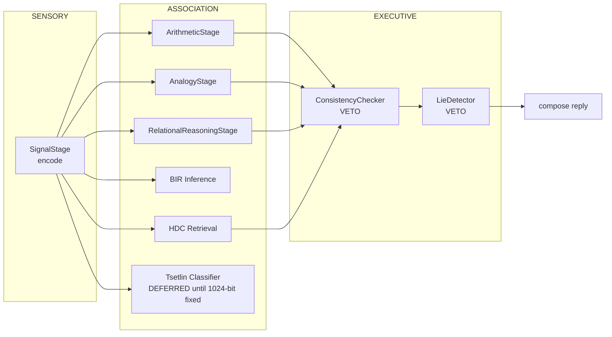

# DESIGN-68 — The Living Connectome: Topology and Migration Plan

**Status:** normative design · W37.1 · 2026-10-12
**Author:** Orchestrator, RECON-W37
**Supersedes:** nothing. **Amends:** nothing. **Builds on:** DESIGN-03 (linear pipeline)

---

## 0. What this document is, and what it is not

This is the **migration plan** from a linear stage pipeline to a weighted graph, derived from
the code as it exists at `3aa5fdc5`. Every claim below is either quoted from source or measured;
per CONSTITUTION Article VI, intent is not a claim.

It is **not** a claim that the graph is wired in. As of `1210e1ee` the graph CORE exists and is
tested (`matrix-brain-runtime/.../graph/`: NodeId, Activation, CognitiveNode, Synapse,
PlasticityRule, SeededRandom, Connectome, HdcNode — 41 tests, 11 mutants killed), but
`TrueMindCycle` still runs the linear ladder from §1 unchanged. The 2-node integration the brief
asks for is proven in `ConnectomeIntegrationTest` against the real serving path; it is not yet a
replacement for a live stage.

Per §5, the sequence is unchanged: replay must be bit-exact on the current pipeline before
topology becomes mutable.

---

## 1. The system as it actually is

### 1.1 TrueMindCycle is a fixed-precedence chain, not a pipeline of interchangeable stages

The stages are constructed, but the **control flow is a hand-written if/else ladder** where the
first match wins:

    SignalStage.encode           -> SignalObservation
    ArithmeticStage.tryEvaluate  ┐
    AnalogyStage.tryEvaluate     ├ fixed precedence, first match returns
    RelationalReasoningStage     ┘
    BirInferenceStage.evaluate
    HdcRetrievalStage.retrieve
    TsetlinStage.classify        -> currently always returns miss() (W36.3)
    SaliencyStage.score
    ConsistencyChecker / LieDetector -> veto, applied AFTER the ladder

Two consequences that the graph proposal must not lose:

1. **The reply is composed from whichever stage matched**, not from a graph readout. There is no
   place today where "several nodes contribute a weighted answer" exists, which is precisely the
   thing §1.1 of the W37 prompt is asking for.
2. **Safety vetoes are applied after stage evaluation.** They are not nodes in a graph, and
   making them nodes would be a *reduction* in safety unless explicitly prevented (see §4.1).

### 1.2 The ladder is what makes the current system reproducible

Ordering is fixed in source. That is a real asset — it is why cognitive trajectories can be
replayed exactly today. Any migration must preserve it as the **initial condition** of the graph,
not discard it. A graph whose topology drifts from the first turn is a different program, and the
seed-based reproducibility argument in §1.2 of the prompt only holds if the topology is itself a
function of `(seed, step)`.

### 1.3 Measured capability floor

    Tsetlin, 16-bit features, all dimensions varying        100%
    Tsetlin, 16-bit features, 15 dimensions constant zero   100%   (was 62.5%, mean of 16 seeds)
    Tsetlin, 1-bit                                          100%
    Tsetlin, parity-3 of 16, 14 constant dims                37%   chance — OPEN
    Tsetlin, parity-4 of 16, 12 constant dims                48%   chance — OPEN
    Tsetlin, production 1024-bit HDC features              unverified

**Updated 2026-10-12.** The constant-dimension collapse previously reported here as 47-55% is
**FIXED**. The cause was `typeOne` rewarding a literal's automaton inclusion-state rather than its
truth value in the input; on a dimension that never varies the two have opposite attractors, so the
clause was driven to require the opposite of what every sample contained. With that corrected,
conjunctions — including every constant-dimension case — score 100% on 16/16 seeds.

`pack()` was also fixed. It returned `words[0]`, discarding 15 of 16 words, so `fires()` examined
16 bits of a 1024-bit production HDC vector while reporting a legitimate-looking fidelity number.

**The binding limitation has moved.** Parity-k with k >= 3 is at chance and was NOT fixed — see
KnownFailures.md "W37.3f", where four hypotheses are eliminated by measurement. The learner is
**conjunction-capable only** until proven otherwise. That still blocks wiring Tsetlin as the
connectome's plastic association node: a plasticity rule applied to a learner that cannot
represent the target reinforces whatever the learner happened to fit, and pruning then removes
correct edges because they look unused.
---

## 2. Proposed topology

### 2.1 Node mapping

| Prompt role | Real class | Node type | Notes |
|---|---|---|---|
| Sensory | `SignalStage` | sensory | encodes to `SignalObservation` |
| Association | `ArithmeticStage` | association | deterministic, no learning |
| Association | `AnalogyStage` | association | deterministic |
| Association | `RelationalReasoningStage` | association | deterministic |
| Association | `BirInferenceStage` | association | to become weighted clauses |
| Association | `HdcRetrievalStage` | association | **the only node with real recall** |
| Association | `TsetlinStage` | association | **deferred** — see §1.3 |
| Executive | `ConsistencyChecker` | veto | **not a normal node** (§4.1) |
| Executive | `LieDetector` | veto | **not a normal node** (§4.1) |
| Motor | reply composition | motor | inline in `TrueMindCycle` today |

`ArithmeticStage` and `AnalogyStage` are deterministic functions with no state. Assigning them
plasticity would be theatre: you cannot Hebbian-learn an answer you already compute exactly. The
plastic graph should cover **HDC retrieval, BIR inference, and Tsetlin** — the three stateful
nodes — and leave deterministic nodes as fixed-weight edges.

### 2.2 The deferred node is the honest part

The prompt's §0 lists `TsetlinTrainer` as a "proven production learning engine... key asset to
reuse." That is contradicted by measurement (`KnownFailures.md`, W37.3). **Tsetlin is marked
DEFERRED in the topology rather than wired in.** Wiring a node whose accuracy is chance at
production width would produce a graph that adapts toward noise, and sleep-time pruning would then
prune the correct connections because they look unused.

---

## 3. Reproducible stochasticity

Seeded RNG derived from `(GlobalSeed, NodeID, StepCount)` is the right design and is compatible
with CONSTITUTION Article I (stratified stochasticity — seeded is explicitly permitted in the
cognitive layer).

The requirement that is **missing** from the prompt: seeding is necessary but not sufficient. With
adaptive topology, `(seed, step)` does not determine the computation, because the graph itself
changes. The seed must therefore cover **topology state** too:

    trajectory = f(GlobalSeed, NodeID, StepCount, topologySnapshotAtStep)

Otherwise two runs with the same seed diverge after the first prune, and the reproducibility claim
is false for exactly the runs anyone would want to replay — the ones where something interesting
changed.

**Audit trail:** every stochastic call logs `{node_id, step, seed, value, outcome}`. This is what
turns "reproducible" from a claim into a checkable property: a replay test can assert the log
matches, rather than asserting the code *should* be deterministic.

---

## 4. Safety invariants the graph must not be able to violate

### 4.1 Veto nodes are structurally excluded from plasticity

A synaptic weight that decays below a threshold gets pruned. If a veto node's incoming edge can
be pruned, then sleep-time pruning can disable the consistency checker under enough pressure, and
the system "learns" to stop checking itself.

**Invariant:** edges into veto nodes are exempt from pruning and LTD. Not tunable, not
configurable, not reachable from the neuromodulator. Enforce it structurally (pruning walks an
edge-type-filtered collection) rather than by convention, because conventions are what §4 of
`KnownFailures.md` shows failing here.

### 4.2 Neuromodulation cannot raise a gate

`NeuroModulatorHub` proposes `Attention`, `Uncertainty`, `Reward`, `Fatigue`. None may *loosen* a
threshold in a veto node. `Attention` may raise retrieval precision in sensory/association nodes
only. The prompt's "safety modulators cannot be bypassed by graph dynamics" (§2,
Constitution Auditor) is a real requirement and is currently **unspecified** — this section is a
first proposal, not a verified one.

### 4.3 Fatigue triggers sleep; sleep must not be suppressible

`Fatigue_Index` → sleep demand is fine. But if `Reward` can cancel `Fatigue`, an environment that
rewards fast answers can prevent consolidation indefinitely. Cap the cancellation and log it.

---

## 5. What must be true before this design is implemented

Ordered by dependency, not by ambition:

1. **Tsetlin must work at production feature width.** Until the 1024→16 projection is designed
   (§1.3), the association node has no learning signal and plasticity has nothing to reinforce.
   This blocks W37.3 and everything downstream of it.
2. **Replay must be bit-exact on the current pipeline** *before* topology becomes mutable. A
   reproducibility harness that only starts working once the graph drifts is a harness that will
   be blamed for the drift.
3. **Pruning must be measured against a held-out set**, not against training loss. W37.3's
   PASS criterion ("network shrinks, accuracy does not drop") is only meaningful with a held-out
   split and a stated protocol. `RuleInductionEngine` already computes an 80/20 split; reuse it
   rather than inventing a second one.
4. **Every claim in §2 needs a benchmark before the tag.** Article VI.

---

## 6. Explicitly not claimed

- The graph CORE exists and is tested (`1210e1ee`), but no graph is wired into `TrueMindCycle`.
  The nine-stage precedence ladder is unchanged and remains the only live path. The 2-node
  integration is proven against the serving path in `ConnectomeIntegrationTest`; it is not yet a
  live stage replacement.
- "Neuromodulation improves retrieval precision" is **unverified**. §2 of the prompt asks to
  "prove Attention affects retrieval precision/recall"; no such measurement has been run, and
  `HDC` similarity thresholds are currently fixed constants.
- "Sleep consolidates and prunes" is **unverified**. `RealSleepScheduler` exists and calls
  `RuleInductionEngine.induce`; consolidation/pruning as described in §1.4 of the prompt does not.
- **Tsetlin is conjunction-capable only.** Parity-3 and wider sit at chance (37-48%) with 2048
  clauses, any `feedbackT`, and either threshold convention; four hypotheses eliminated by
  measurement. Constant-dimension and conjunction cases are 100%. See §1.3 and KnownFailures.md
  "W37.3f". Until parity is fixed, Tsetlin must not be wired in as a plastic association node.
- **Rule induction has N <= 20.** Article II `K_MAX=20` caps `RuleInductionEngine.induce()` at 20
  inputs, so its 80/20 split leaves 4 test samples. Any fidelity figure from that path must state N;
  measured values ranged from 0.000 to 1.000 across data seeds on the same task.